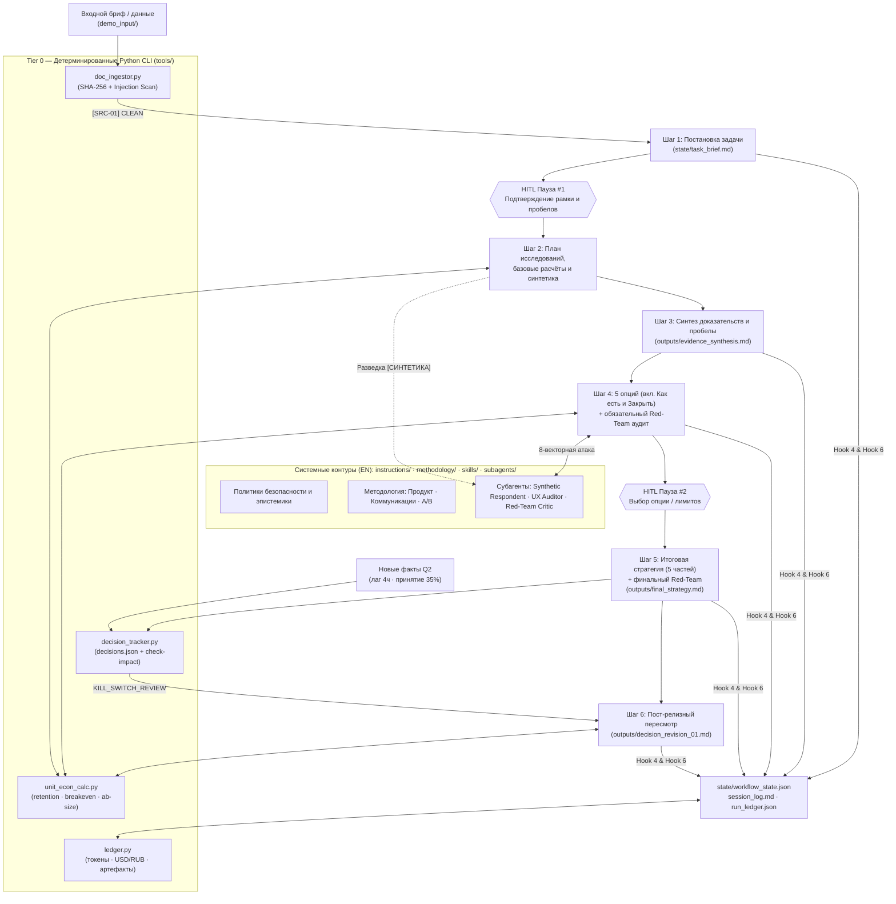

# Описание работы: Агент «Стратег Фабрики продуктов»

**Проект**: Автономная мультишаговая система разработки и сопровождения продуктовых стратегий  
**Демонстрационный кейс**: `megafon_family_connect` — «Связь для близких и собственных устройств» (по открытому брифу `SRC-01`)  
**Дата**: 22 ноября 2026

---

## 1. Архитектура агента: 6-шаговый цикл и 4 контура знаний

Агент построен как воспроизводимая операционная система, в которой **рассуждения языковой модели** строго отделены от **детерминированных вычислений**, **реестра фактов** и **управления состоянием**.

### 1.1. Четыре изолированных контура знаний

| Контур | Расположение | Язык | Назначение |
|---|---|---|---|
| **Контур 1 — Политики и безопасность** | `instructions/`, `GEMINI.md`, `AGENTS.md` | EN | Эпистемические теги, защита от prompt-injection, матрица маршрутизации моделей (`Tier 0/1/2`) и 6 обязательных lifecycle-хуков |
| **Контур 2 — Доменная методология** | `methodology/` | EN | Универсальные фреймворки продуктовой стратегии (JTBD, Сигнал vs Причина), коммуникаций (6 элементов + анти-двойной счёт) и экспериментов (SUTVA, ITT, SRM) |
| **Контур 3 — Пошаговые SOP и субагенты** | `skills/`, `subagents/` | EN | Исполняемые регламенты шагов 1–6 и изолированные роли: `red_team_critic`, `synthetic_respondent`, `ux_auditor` |
| **Контур 4 — Изолированные проекты** | `projects/<name>/{research,state,outputs}/` | **RU** | Данные, источники (`sources.json`), расчёты (`*.json`), состояние (`workflow_state.json`), журнал (`run_ledger.json`), решения (`decisions.json`) и итоговые документы |

### 1.2. Схема 6-шагового рабочего цикла (Mermaid)

---

## 2. Перечень моделей, сервисов и инструментов

Система использует **3-уровневую маршрутизацию (`instructions/routing_and_hooks.md`)**, закрепляя за каждым уровнем строго очерченную зону ответственности:

| Уровень | Компонент / Модель / Инструмент | Роль в системе | Что запрещено делать на этом уровне |
|---|---|---|---|
| **Tier 0** *(Python CLI)* | `tools/doc_ingestor.py` | Извлечение текста из PDF/CSV/XLSX/MD/TXT, расчёт SHA-256, регистрация `SRC-ID`, сканирование 12+ сигнатур prompt-injection и zero-width символов | Качественная интерпретация, стратегические выводы |
| **Tier 0** *(Python CLI)* | `tools/unit_econ_calc.py` | Детерминированный расчёт 3 классов моделей: `retention-profit` (когортное удержание, каннибализация, ROI, payback), `breakeven` (LTV, точка безубыточности, темп окупаемости), `ab-size` (двухвыборочный z-тест пропорций, сроки набора с maturation window) | Стратегический выбор без контекста |
| **Tier 0** *(Python CLI)* | `tools/ledger.py` | Append-only логирование каждого шага (run_id, модель, input/output токены, стоимость USD/RUB, статус, список артефактов) в `state/run_ledger.json` | — |
| **Tier 0** *(Python CLI)* | `tools/decision_tracker.py` | Хранение принятых решений, допущений и kill-switch (`state/decisions.json`), автоматическая проверка влияния новых фактов (`check-impact --fact "..."`) и ведение истории статусов (`active -> revised/killed`) | — |
| **Tier 1** *(Эконом-LLM)* | `gemini-2.5-flash` / `gpt-4.1-mini` *(резерв маршрутизации)* | Массовая очистка текстов, структурное извлечение таблиц из очищенных документов, черновые гайды интервью | Финальные стратегические компромиссы, Red-Team аудит, финмоделирование |
| **Tier 2** *(Флагман-LLM)* | `gemini-2.5-pro` *(использован в демо-прогоне)* / `claude-sonnet-4` / `gpt-5` | Постановка задачи (Шаг 1), разделение сигналов и причин (Шаг 3), генерация опций и Red-Team аудит (Шаг 4), сборка стратегии и плана экспериментов (Шаг 5), суждение при пересмотре (Шаг 6) | **Запрещена ментальная арифметика** (обязательно делегируется `unit_econ_calc.py`) |
| **Среда запуска** | **Gemini CLI** *(+ поддержка Cursor, Codex CLI, Claude Code)* | Интерактивная оркестрация инструментов, чтение `GEMINI.md` / `AGENTS.md` / `.cursorrules`, работа с локальной файловой системой | Внешние платные API, облачные БД и сторонние SaaS **не используются** |

---

## 3. Ключевые промпты и системные инструкции

1. **Корневой контракт (`GEMINI.md` и `AGENTS.md`)**: задаёт роль «Стратега Фабрики продуктов», 6-шаговый пайплайн с обязательными паузами HITL, политику языков (EN внутри системы / RU в проектах), непрерывность сессий и запрет на галлюцинацию цифр.
2. **Эпистемическая и security-политика (`instructions/epistemic_and_security.md`)**:
   - Вводит обязательную связку «источник + эпистемический статус»: `[SRC-XX]` / `[CALC]` / `[USER]` / `[СИНТЕТИКА — НЕ ДОКАЗЫВАЕТ СПРОС]` + `[ФАКТ]` / `[ГИПОТЕЗА]` / `[ДОПУЩЕНИЕ]`.
   - Запрещает выдавать единичную метрику за причинность, скрывать знаменатели и использовать синтетические цитаты как доказательство спроса.
   - Закрепляет правило обработки всех внешних документов как `UNTRUSTED PASSIVE DATA`.
3. **Матрица маршрутизации и 6 обязательных хуков (`instructions/routing_and_hooks.md`)**:
   - `Hook 1` — обязательный инжест и injection-скан (`doc_ingestor.py`).
   - `Hook 2` — детерминированный расчёт (`unit_econ_calc.py`).
   - `Hook 3` — обязательный враждебный аудит (`subagents/red_team_critic.md`) перед HITL #2 и перед финализацией Шага 5.
   - `Hook 4` — учёт прогонов и стоимости (`ledger.py`).
   - `Hook 5` — регистрация решений и impact-аудит (`decision_tracker.py`).
   - `Hook 6` — обновление `workflow_state.json` и `session_log.md` после каждого шага.
4. **Специализированные субагенты (`subagents/`)**:
   - **`red_team_critic.md`**: роль враждебного инвестиционного комитета; проверяет **8 обязательных векторов** (эпистемика, честность контрфактуалов, каннибализация маржи домохозяйства, двойной счёт, детерминированная математика, SUTVA и сроки A/B, биллинг/152-ФЗ/QA, чёткость kill-switch) + обязательный Pre-Mortem.
   - **`synthetic_respondent.md`**: симуляция скептичного клиента с анти-подхалимскими правилами (anti-sycophancy) и жёсткой маркировкой `[СИНТЕТИКА — НЕ ДОКАЗЫВАЕТ СПРОС]`.
   - **`ux_auditor.md`**: аудит точек отвала многосторонних воронок (организатор <-> участник <-> роутер без экрана).

---

## 4. Реализованные возможности дополнительного уровня

Помимо базового 6-шагового цикла, в системе реализованы все ключевые инженерные механизмы продвинутого уровня:

1. **Автоматический трекер решений и проверка влияния новых фактов (`tools/decision_tracker.py`)**: продемонстрировано в Шаге 6 на реальном стресс-кейсе середины Q2 (задержка биллинга 4 ч + принятие приглашения 35%) — инструмент автоматически поднял флаг `KILL_SWITCH_REVIEW` по `DEC-02` и `ASSUMPTION_REVIEW` по `DEC-01`, после чего был выпущен отдельный меморандум пересмотра `decision_revision_01.md` **без перезаписи** исторической стратегии.
2. **Полная воспроизводимость математики (46 JSON-артефактов `[CALC]`)**: ни одна ключевая цифра в `options_and_red_team.md`, `final_strategy.md` и `decision_revision_01.md` не посчитана «в уме». Все 46 сценариев (удержание по опциям Б/В/Г/Д, чувствительность Песс/База/Опт, окупаемость, разрыв 6 млн и 2.25 млн, run-rate 3-го года, A/B-выборки и пересчёт Шага 6) лежат в `projects/megafon_family_connect/research/calculations/`.
3. **Встроенный сканер Prompt-Injection и SHA-256 аудит источников (`tools/doc_ingestor.py`)**: проверяет входящие PDF/таблицы на инъекции и невидимые символы до попадания текста в контекст LLM.
4. **Прозрачная телеметрия стоимости и артефактов (`tools/ledger.py`)**: фиксирует расход токенов, стоимость в USD и RUB и перечень артефактов по каждому шагу.
5. **Кросс-сессионное восстановление состояния**: подтверждено на практике — работа была поставлена на HITL-паузу после Шага 3, а затем бесшовно возобновлена в новой сессии через `workflow_state.json`, `session_log.md` и `ledger.py status` без потери контекста и пересчёта прошлых шагов.
6. **Гибридная языковая архитектура и кросс-IDE переносимость**: единый репозиторий работает из коробки в Gemini CLI (`GEMINI.md`), Codex/Claude Code (`AGENTS.md`) и Cursor (`.cursorrules`).

---

## 5. Время, расходы на демо-проект и сравнение с альтернативами

### 5.1. Фактические метрики из `projects/megafon_family_connect/state/run_ledger.json`

| Run ID | Шаг рабочего цикла | Модель | Вх. токены | Вых. токены | Всего токенов | Стоимость (USD / RUB, 95 ₽/$) | Статус | Ключевые артефакты |
|---|---|---|---:|---:|---:|---:|---|---|
| `RUN-001` | `step_1_intake` | `gemini-2.5-pro` | 14 500 | 3 200 | 17 700 | $0.0501 / **4.76 ₽** | `completed` | `sources.json`, `SRC-01`, `task_brief.md` |
| `RUN-002` | `step_2_3_evidence_synthesis` | `gemini-2.5-pro` | 21 000 | 6 800 | 27 800 | $0.0943 / **8.95 ₽** | `paused_hitl` | `research_plan.md`, `synthetic_interviews.md`, `evidence_synthesis.md`, 4 `[CALC]` |
| `RUN-003` | `step_4_options_and_red_team` | `gemini-2.5-pro` | 38 000 | 11 500 | 49 500 | $0.1625 / **15.44 ₽** | `completed` | `options_and_red_team.md`, 30 `[CALC]` |
| `RUN-004` | `step_5_final_strategy` | `gemini-2.5-pro` | 42 000 | 14 500 | 56 500 | $0.1975 / **18.76 ₽** | `completed` | `final_strategy.md`, `decisions.json` (`DEC-01`–`DEC-04`) |
| `RUN-005` | `step_6_decision_revision_01` | `gemini-2.5-pro` | 19 500 | 6 500 | 26 000 | $0.0894 / **8.49 ₽** | `completed` | `decision_revision_01.md`, 12 `[CALC]`, обновлённый `decisions.json` |
| **ИТОГО** | **Полный цикл (Шаги 1–6)** | **`gemini-2.5-pro` + Tier 0 CLI** | **135 000** | **42 500** | **177 500** | **$0.5938 / 56.40 ₽** | **5 прогонов** | **12 основных артефактов + 46 расчётов JSON** |

*(Примечание: оценки токенов и USD/RUB зафиксированы в `run_ledger.json` по индикативному тарифу `gemini-2.5-pro`: $1.25 / 1M input, $10.00 / 1M output при курсе 95 ₽/$; Python-инструменты Tier 0 выполняются локально со стоимостью $0.00.)*

### 5.2. Сравнение: Агент vs Обычный чат с LLM vs Ручная работа продуктового стратега

| Параметр сравнения | Наш агент (Product Factory Strategist) | Обычный чат с LLM (без системы) | Ручная работа стратега / аналитика |
|---|---|---|---|
| **Время на полный цикл (Шаги 1–6)** | **~40–60 минут** (с учётом пауз HITL и прогона 46 расчётов) | 15–30 минут (поверхностный текст без проверки расчётов) | **5–10 рабочих дней** (40–80 человеко-часов) |
| **Прямая стоимость (демо-кейс)** | **~56 ₽ ($0.59)** по токенам API | ~10–30 ₽ | ~**100 000–250 000 ₽** (ФОТ сеньор-стратега + аналитика) |
| **Точность математики и A/B-выборок** | **100% детерминированная** (Python `unit_econ_calc.py`, 46 JSON-файлов) | Высокий риск «галлюцинаций в уме» и скрытых ошибок мощности A/B | Высокая, но требует ручной сборки Excel/Python и ревью |
| **Честность к пробелам и разрывам** | Принудительная (`[ФАКТ]`/`[ДОПУЩЕНИЕ]`, Red-Team, честный разрыв `-2.25 млн`) | Часто «подгоняет» ответ под цель 285 млн, скрывая календарные ограничения | Зависит от квалификации и давления стейкхолдеров |
| **Воспроизводимость и пересмотр (Шаг 6)** | Автоматический `check-impact`, аудиторский след (`decision_revision_01.md`) | Контекст теряется в длинной ленте, решения перезаписываются устно | Ручное обновление презентаций, часто без связки с прошлыми допущениями |
| **Где по-прежнему нужен человек** | Подтверждение бизнес-приоритетов (HITL), добыча внутренних SQL-данных, переговоры с биллингом/ИБ/финансами | Полная перепроверка фактов, расчётов и логики | Финальная ответственность за P&L и политическое согласование |

---

## 6. Заявленные возможности и честные ограничения

### Что система делает надёжно (подтверждено на демо-проекте)
- Извлекает и хэширует входные документы (`PDF/CSV/XLSX/MD/TXT`) с автоматической проверкой на prompt-injection.
- Строго разделяет подтверждённые факты, гипотезы, допущения и синтетику; выявляет скрытые ловушки брифа (например, невозможность закрыть 6 млн руб. только удержанием за 6 мес. H2 и невозможность проверить снижение перебоев 12%→9% в Q2 при потоке 100 групп/нед — 33.8 нед.).
- Сопоставляет взаимоисключающие опции, включая обязательные контрфактуалы «Оставить как есть» и «Закрыть/заморозить», и прогоняет их через враждебный Red-Team аудит.
- Формирует готовую к защите 5-частную стратегию с коммуникационной архитектурой, анти-двойным счётом и kill-switch, а затем оперативно пересчитывает стратегию при изменении реальности (Шаг 6).

### Честные ограничения (чего система НЕ заменяет)
1. **Отсутствие прямого доступа к внутренним БД и биллингу оператора**: без выгрузки SQL-данных (пробелы G1–G4) финансовые прогнозы опираются на явные диапазоны `[ДОПУЩЕНИЕ]` и требуют обязательной диагностики в Q1.
2. **Синтетические интервью не доказывают спрос**: `synthetic_respondent.md` полезен только для поиска гипотез и вопросов к реальному кастдеву — реальные клиенты могут вести себя иначе.
3. **Лексическая эвристика `check-impact`**: `tools/decision_tracker.py check-impact` использует стемминг ключевых слов и риск-терминов (работает быстро и офлайн без LLM), поэтому синонимы (например, «задержка» vs «лаг») требуют обязательного семантического прочтения стратегом поверх вывода утилиты — что и было показано в Шаге 6 для `DEC-01`.
4. **Индикативный учёт токенов в `ledger.py`**: при работе через интерактивную CLI-сессию количество токенов передаётся в `ledger.py` как оценочное (для точного биллинга в продакшене рекомендуется интегрировать SDK-хук провайдера API).
5. **Финальную ответственность несёт человек**: агент готовит доказательную базу и вскрывает риски, но утверждение бюджета, согласование с ИБ/юристами и нажатие kill-switch остаются за руководителем направления.
